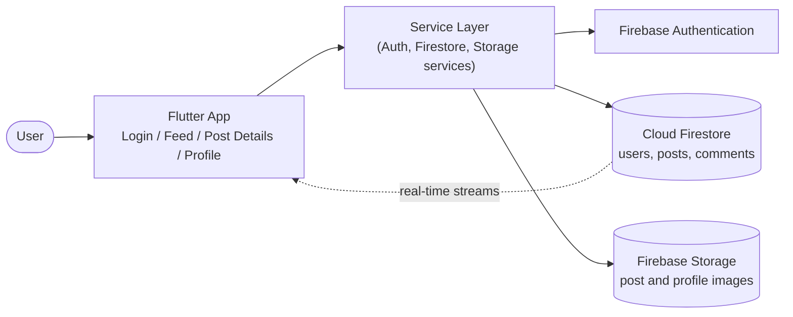

# TownTalk

A Firebase-powered social app that connects people within a town or locality, so neighbours can share updates, start conversations and stay in touch with what is happening around them.

> Built with Flutter and Firebase.

## Features

- **Authentication**: sign up and log in securely with Firebase Authentication
- **Posts and updates**: share text and images with your town community
- **Real-time feed**: new posts and comments appear instantly using Cloud Firestore
- **Comments and likes**: join the conversation on any post
- **User profiles**: view and edit your profile
- **[Add or remove: chat, town/locality groups, search]**

## Tech Stack

| Layer | Technology |
|---|---|
| Framework | Flutter (Dart) |
| Authentication | Firebase Authentication |
| Database | Cloud Firestore |
| File storage | Firebase Storage |

## Getting Started

### Prerequisites

- Flutter SDK (3.x or later) and Dart
- A Firebase project with Authentication, Firestore and Storage enabled
- Android Studio or VS Code with the Flutter extension

### Installation

```bash
git clone https://github.com/swapnika-456/towntalk.git
cd towntalk
flutter pub get
```

### Firebase Setup

1. Create a project in the [Firebase Console](https://console.firebase.google.com/).
2. Add an Android app (and iOS if needed) and download `google-services.json` into `android/app/`.
3. Enable **Email/Password** sign-in under Authentication.
4. Create a Firestore database and Storage bucket.
5. Alternatively, run `flutterfire configure` to generate `firebase_options.dart`.

### Run

```bash
flutter run
```

## System Architecture



**How it works**

1. **Authentication**: users sign up and log in through Firebase Authentication.
2. **Service layer**: the app talks to Firebase only through service classes, keeping UI code separate from backend calls.
3. **Data**: users, posts and comments live in Cloud Firestore.
4. **Media**: images are uploaded to Firebase Storage and the download URL is saved on the post or profile document.
5. **Real-time updates**: Firestore streams push new posts and comments to the feed without a manual refresh.

## Project Structure

```
lib/
├── models/        # data models (user, post, comment)
├── services/      # Firebase auth, Firestore and storage services
├── screens/       # login, feed, post details, profile
├── widgets/       # reusable UI components
└── main.dart
```

> Adjust this tree to match your actual folders.

## Firestore Structure

```
users/{userId}
posts/{postId}
posts/{postId}/comments/{commentId}
```

> Update with your actual collections and fields.

## Screenshots

| Login | Feed | Profile |
|---|---|---|
| _add image_ | _add image_ | _add image_ |

## Roadmap

- [ ] Direct messaging
- [ ] Town-based groups and events
- [ ] Post moderation and reporting

## Author

**Swapnika Bapatu**
[LinkedIn](https://www.linkedin.com/in/swapnika-bapatu-a263a6294/) · [GitHub](https://github.com/swapnika-456)

## License

[MIT / add license]
